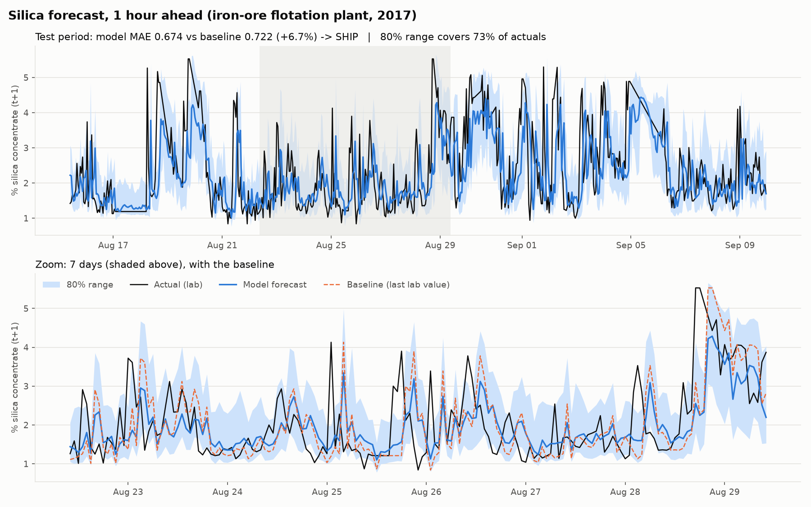

# mini-company-brain

A silica forecaster for an iron-ore flotation plant, with a **ship gate**: the model replaces the
simple forecast only if it beats it on data it has never seen.



## The problem

Flotation separates iron ore from silica (sand). Less silica in the concentrate = better product.
The plant learns the silica level from a lab assay that takes about **2 hours**, so operators are
always reacting to the past. Goal: **forecast % Silica Concentrate 1 hour ahead**, with an 80% range,
and ship the model only if it beats the current practice.

Data: [Quality Prediction in a Mining Process](https://www.openml.org/d/43311) (OpenML 43311,
also on Kaggle). Real plant data, March to September 2017, 737,453 rows, 24 columns.

## Results

| | Baseline | Model (v2) |
|---|---|---|
| Validation MAE (%-points) | 0.646 | 0.584 (-9.6%) |
| **Test MAE** | **0.722** | **0.674 (-6.7%)** |
| 80% range, test coverage | | 73% (target 80%) |

**Ship gate: model must be at least 5% better than the baseline on test MAE -> `SHIP`.**

The first model (v1) tied the baseline and was blocked by the gate. See
[reports/model_history.md](reports/model_history.md).

## How a forecast is made

```
 hour:      t-4   t-3   t-2   t-1    t   | t+1
 sensors:    .     .     X     X     X   |        (air flow, levels, pH, density, dosing)
 lab:        X     X     X     -     -   |        (results for t-1, t not back yet)
 target:                                 |  ?     silica at t+1
 baseline:               X ------------------>    "same as the last lab value"
```

At hour `t` the model sees sensor readings up to `t` and lab results up to `t-2`. It predicts
**how much silica will change** from the last lab value, and adds that change to it.

## Decisions (and why)

| Decision | Why |
|---|---|
| **Time-based split** 70/15/15, no shuffling | Neighbouring hours are near-duplicates. A random split puts them in both train and test, so the model "remembers" the answer and the score is inflated. A time split asks the real question: does it work on *next month*? |
| **Lab values lagged >= 2 h** | That's how long the assay takes. Using fresher lab data would be using information the plant doesn't have yet. A test checks this. |
| **Never use % Iron Concentrate** | It comes from the same lab test as the target, so it would leak the answer. |
| **Baseline = persistence** (last available lab value, `silica(t-2)`) | It's what operators effectively do today, and it follows the same 2 h rule as the model, so the comparison is fair. A baseline that used `silica(t)` would cheat. |
| **Hourly resolution** | The target is hourly. Sensors (every 20 s) are averaged per hour; lab columns use the **first** value of each hour, because 310 hours contain within-hour interpolation that drifts toward the *next* assay (a hidden leak if averaged). |
| **Missing hours become explicit empty rows** | So "2 rows back" always means "2 hours back", even across the 13-day gap in March. HistGradientBoosting handles the resulting NaNs natively. |
| **MAE + `absolute_error` loss** | Same units as silica (%-points), easy to explain, not dominated by spikes. Train on what you're judged on. |
| **Predict the change, not the level** (v2) | The average silica level drifts (2.32 train, 2.43 test). Tree models can't predict outside their training range; predicting the move from the last lab value avoids that. Chosen on validation. |
| **Tune on validation, score test once per version** | Keeps test an honest stand-in for production. Both test scores (v1, v2) are logged. |
| **Gate = 5% margin**, not "any improvement" | Replacing a working process has a cost; a 0.5% win can be noise. |
| **Quantile models (0.1 / 0.9) for the 80% range** | Gives operators "how sure are we", not just a number. Reported, not tuned on test. |

## Honest limitations

- **The 80% range covers only 73% of test values.** It's overconfident: the test period is more
  volatile than the training period (baseline error rose from 0.646 to 0.722). I didn't widen it to
  hit 80% on test, because that would be tuning on the test set.
- **The win is narrow.** 9.6% on validation shrank to 6.7% on test, clearing the 5% gate by 1.7 points.
- **The model misses sharp spikes**; it mainly helps between them (see the zoom in the plot).
- **Data quirks:** stretches where lab silica stays flat for a day (e.g. Aug 17-18) look filled-in,
  not measured. One 13-day gap in March 2017. Details in [reports/data_quality.md](reports/data_quality.md).
- One train/val/test split, one plant, 6 months.

## Next steps

1. **Walk-forward backtest:** re-run the gate month by month, not on one split, to see if the win is stable.
2. **Calibrate the range** with conformal prediction on validation residuals, then add coverage to the gate.
3. **Monitoring in production:** track live MAE vs baseline and input drift; re-run the gate before every retrain.
4. **Richer features:** within-hour sensor statistics from the 20 s data (std, trend), process-time delays.
5. **Flag suspicious lab data** (flat stretches) and exclude it from training and scoring.

## Run it

```
python -m venv .venv
.venv\Scripts\pip install -r requirements.txt
.venv\Scripts\python run.py          # downloads data on first run (~185 MB from OpenML)
.venv\Scripts\python -m pytest       # leakage rules, split order, gate, drift
```

Outputs: `reports/data_quality.md`, `reports/metrics.json`, `reports/model_history.md`,
`reports/forecast_test.png`.

| File | Step |
|---|---|
| `brain/clean.py` | load, fix decimals, hourly resample, data-quality report |
| `brain/features.py` | lags, leakage rules, baseline, time split |
| `brain/train.py` | tuning, v2 model, quantile range, ship gate |
| `brain/plot.py` | test-period chart |
| `tests/test_leakage.py` | the rules, as tests |

Built with pandas, NumPy, scikit-learn, matplotlib and pytest. Developed with help from Claude Code.
